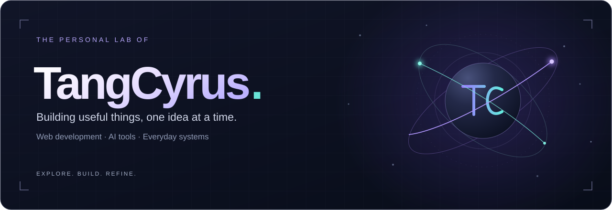
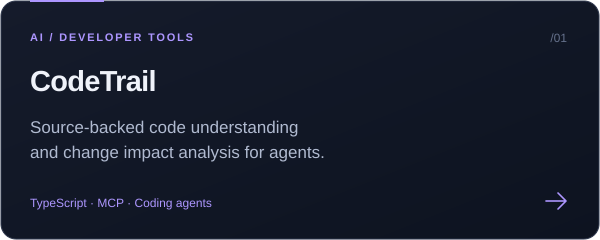
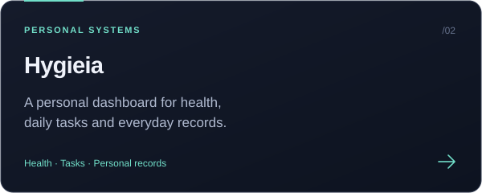
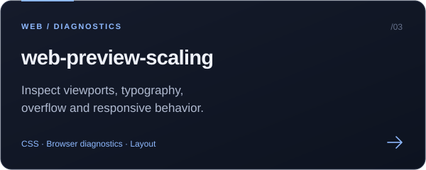
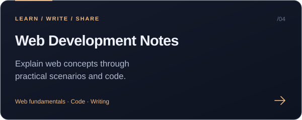

<!-- Profile artwork is stored locally in assets/; social links are in the hero area and Connect section. -->

  <picture><source media="(max-width: 600px)" srcset="./assets/hero-mobile.svg" /></picture>

  <picture><source media="(max-width: 600px)" srcset="./assets/typing-mobile.svg" /></picture>

  

  <a href="#about--关于我">关于我</a> ·
  <a href="#selected-work--精选项目">精选项目</a> ·
  <a href="https://github.com/TangCyrus?tab=repositories">全部仓库</a>

## About / 关于我

你好，我是 **Cyrus**。我在探索 Web 开发与 AI 工具，也把日常生活中的需求做成可以使用的项目。

- **开发工具**：探索让 Coding Agent 理解源码、追踪关系与评估改动影响的方法。
- **个人系统**：将健康、任务与生活记录连接起来，构建自己的日常工作台。
- **学习记录**：通过具体场景、代码示例和验证，把遇到的问题讲清楚。

> 从一个具体的问题出发，把想法做出来，再持续打磨。

## Selected work / 精选项目

<table>
  <tr>
    <td width="50%"><a href="https://github.com/TangCyrus/CodeTrail"><picture><source media="(max-width: 600px)" srcset="./assets/codetrail-mobile.svg" /></picture></a></td>
    <td width="50%"><a href="https://github.com/TangCyrus/Hygieia"><picture><source media="(max-width: 600px)" srcset="./assets/hygieia-mobile.svg" /></picture></a></td>
  </tr>
  <tr>
    <td><a href="https://github.com/TangCyrus/web-preview-scaling"><picture><source media="(max-width: 600px)" srcset="./assets/web-preview-mobile.svg" /></picture></a></td>
    <td><a href="https://github.com/TangCyrus/-"><picture><source media="(max-width: 600px)" srcset="./assets/notes-mobile.svg" /></picture></a></td>
  </tr>
</table>

## Activity / 代码足迹

  <picture>
    <source media="(prefers-color-scheme: dark)" srcset="./assets/contributions-dark.svg" />
    <source media="(prefers-color-scheme: light)" srcset="./assets/contributions-light.svg" />
    
  </picture>

每一格都是一次积累 · 由公开贡献数据生成，每日自动更新

## Connect / 保持联系

在 [X · @CyrusTangcyrus](https://x.com/CyrusTangcyrus) 找到我，也欢迎通过上面的项目仓库交流问题与想法。

---

